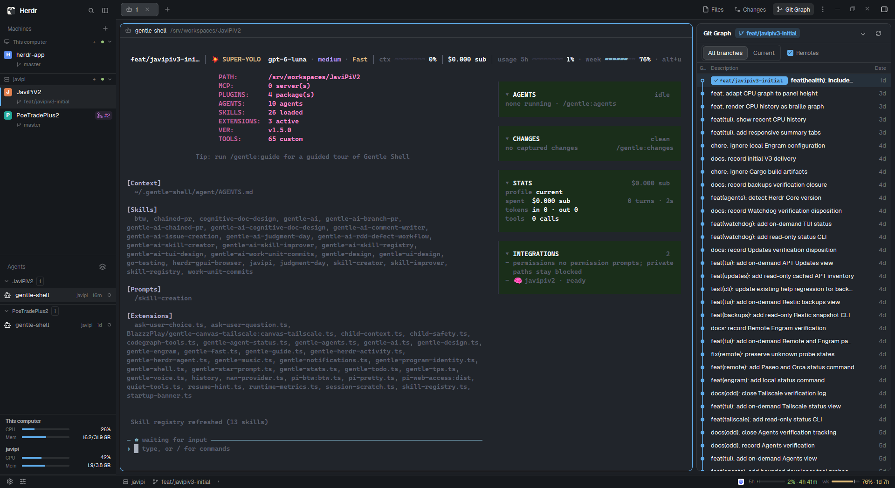

# Javijec

Javijec is a portable Herdr layout and set of custom mods for working across local and remote machines. It brings machine-aware Spaces and Agents, file and Git tools, GitHub and Linear integrations, and an optional Gentle Shell panel into one workspace. It is a Herdr configuration package, not a replacement for Herdr or Gentle Shell.



## What’s included

The `javijec` layout combines:

- **Machine-aware sidebar:** Machines, Spaces, and Agents, with CPU and memory vitals. Disconnected machines collapse and hide their Spaces; their Agents are dimmed and cannot be opened. Reconnecting restores the saved fold preference.
- **Workspace tabs and tools:** Files, Changes, Git Graph, Pull Requests, Linear Issues, and Gentle Shell. Changes is selected by default. The panel can be switched from the toolbar.
- **Workspace footer:** command shortcut beside Settings, plus workspace/session context, model and effort, agent count, and provider usage limits.
- **Expandable TODOs:** the Gentle Herdr panel can show recent task history and TODOs; individual tasks expand to reveal their note and full title.
- **Themes:** `gentle`, `gentleman-cute`, and `gentleman-sexy` are included as optional themes. The layout uses Herdr’s `paper` theme in light mode and `atom-one-dark` in dark mode.

## Included mods

| Mod | Role |
| --- | --- |
| `workspace-chrome` | Workspace header and footer controls. |
| `jec-sidebar` | Machine-aware Machines, Spaces, Agents, and machine vitals. |
| `jec-tabs` | Workspace tabs and tool-panel buttons. |
| `jec-files` | File browser and viewer/editor. |
| `jec-changes` | Git changes, staging, commit actions, and pane header. |
| `better-git-graph` | Git history and branch graph. |
| `jec-branch-pr` | GitHub pull-request browsing and actions. |
| `jec-branch-issue` | Linear issues and issue worktrees. |
| `workspace-status` | Workspace and model/context information in the footer. |
| `jec-usage-limits` | Provider usage windows. |
| `gentle-herdr-sidebar` | Optional Gentle Shell snapshots, changes, TODOs, and limited task history. |

The layout and mods are under `layouts/` and `mods/`; optional themes are under `themes/`.

## Install

You need Herdr installed. On Windows, use the included PowerShell installer from the repository root:

```powershell
.\install-layout.ps1 -WhatIf
.\install-layout.ps1
```

The installer defaults to `%USERPROFILE%\.config\herdr-app`, or `$env:HERDR_APP_HOME` when set. `-HerdrAppHome <path>` selects another app home. Existing files that differ are left untouched by default. Use `-ReplaceExisting` only if you want the installer to back them up under `.herdr-layout-backups` and replace them. Add `-Activate` to switch to Javijec after a conflict-free install.

On macOS or Linux, or if you prefer to install manually, copy while preserving the directory structure:

- `layouts/javijec.json` to `<HERDR_APP_HOME>/layouts/`
- `mods/*` to `<HERDR_APP_HOME>/mods/`
- `themes/*` to `<HERDR_APP_HOME>/themes/`

Do not overwrite same-named custom mods without comparing them first. Check the installed mods and activate the layout with Herdr’s CLI:

```sh
herdr-app check mods/<mod-name>
herdr-app do layout.switch '{"name":"javijec"}'
```

Run `herdr-app check` for each installed mod. The layout uses Herdr’s normal layout switching; this package does not install global Herdr settings, personal shared state, or workstation-specific key bindings.

## Optional Gentle Shell panel

The Gentle Shell panel is separate from Herdr’s terminal panes. It reads bounded snapshots published by the Pi extension at `extensions/gentle-herdr-bridge.mjs`; by default they are stored under `~/.gentle-herdr`, or under `GENTLE_HERDR_DIR` if configured.

The layout installer does **not** install or enable the extension. Keep `extensions/gentle-herdr-bridge.mjs` together with `bridge/`, then load it through Gentle Shell/Pi’s normal extension workflow. The package declares the extension in `package.json` under `pi.extensions`.

This panel is a limited snapshot view, not live Gentle Agents progress or a one-to-one copy of Gentle Shell’s Agents rail. Missing, stale, malformed, or out-of-scope snapshots remain unavailable rather than being guessed.

## Integrations and requirements

- **Git tools:** Git and a valid repository are needed for repository-dependent panels and actions. Some worktree operations fetch remote refs.
- **GitHub Pull Requests:** requires the GitHub CLI (`gh`) installed and authenticated. Some actions write to GitHub.
- **Linear Issues:** requires `LINEAR_API_KEY` and the bundled Windows helper. Other platforms need a compatible helper build. Linear requests use the network.
- **Usage limits:** depend on the provider applications and local usage data available on that machine; some provider data may be unavailable.

Mods are trusted code, not sandboxed extensions. Review them before installing or changing them.

## Development checks

Run the repository test suite from the project root:

```sh
npm test
```

For a mod-specific host/API check, run:

```sh
herdr-app check mods/<mod-name>
```

The Linear helper is a separate Go module. Its tests, when working on that helper, run from its directory:

```sh
cd mods/jec-branch-issue/helper
go test ./...
```

## Share-page materials

`RECIPE.md` and `preview.png` are also used as the layout’s share-page description and preview. Before publishing the package publicly, review `preview.png` for workspace names or terminal content that should not be shared.
