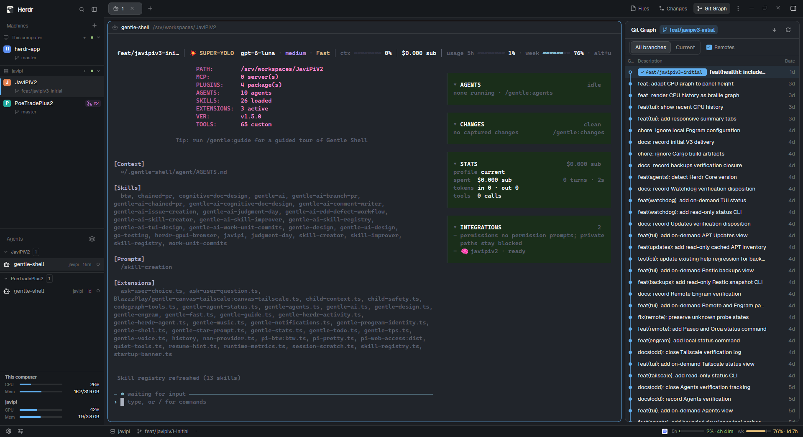

# Javijec

Javijec is a complete Herdr workspace layout: a machine-aware sidebar, active terminal panes, and a right-hand stack of file, Git, pull-request, and issue tools. It keeps the currently selected panel and uses the same light/dark themes on every machine. 

## What you see

- **Left sidebar (268 px):** a 46 px workspace title bar; Machines, Spaces, and Agents sharing the remaining height; collapsible CPU/memory vitals beneath each machine; and a 28 px footer. The sidebar has a dark `chrome` background and can be resized from 44 to 480 px.
- **Top workspace row (42 px):** tabs and panel buttons for Files, Changes, Git Graph, Pull Requests, and Linear Issues.
- **Center work area:** the active tab and its terminal panes. Each pane has an always-visible 30 px Better Changes header, an 8 px gap, a 10 px radius, a border, and an accent focus border.
- **Right tool panel (368 px):** a resizable stack (280–900 px) containing Files, Changes, Git Graph, Pull Requests, and Linear Issues. The package defaults to Git Graph; the panel button selects another tool.
- **Bottom status row (28 px):** workspace/agent status and provider usage limits.
- **Appearance:** the layout fixes light mode to `paper` and dark mode to `atom-one-dark`. The included `gentle`, `gentleman-cute`, and `gentleman-sexy` themes are optional alternatives in Herdr's theme picker; Javijec does not select them automatically.

## How it behaves

- Spaces and agents are shown by machine. Herdr agent states are `blocked`, `done`, `working`, and `idle`; the most urgent state takes precedence in a workspace (`blocked > done > working > idle`). Selecting a space or agent changes the active work context.
- The top buttons switch the right-hand panel; the selected panel is remembered by Better Tabs. Files browses the active workspace; Changes shows working-tree/commit changes; Git Graph shows branches and history; the PR and issue panels expose their respective integrations.
- The pane header is supplied by Better Changes. Pane framing follows the active tab and Herdr's normal pane focus, split, zoom, and close behavior.
- The vitals panel reports CPU and memory for machines; it intentionally does not show disk usage.
- The status row summarizes the current machine/workspace and agent count alongside provider usage windows.
- The layout uses standard Herdr layout switching; `ctrl-shift-l` cycles layouts. Panel buttons are mouse controls; this package does not include workstation-specific `keys.json` bindings.

## Built from

The layout tree is a root row with a 268 px sidebar and a flexible workspace column. The workspace column contains a 42 px tab/button row, a work row with the active tab and the 368 px tool-panel stack, and a 28 px status row. The active-panel state is set to Git Graph; the panel can be changed in the UI.

Custom mods included under `mods/`:

- `workspace-chrome` — title/brand bar.
- `my-better-sidebar` — machine-aware Machines, Spaces, Agents, per-machine vitals, and footer views.
- `my-machine-vitals` — CPU and memory sampling rendered inside the Machines list.
- `better-tabs` — tab row and tool-panel buttons.
- `better-files` — file browser.
- `better-changes` — changes/commit panel and pane header.
- `better-git-graph` — Git history and branch graph.
- `branch-pr` — GitHub pull-request panel.
- `branch-issue` — Linear issue and worktree panel.
- `workspace-status` — bottom workspace status.
- `usage-limits` — provider usage limits.

The package also includes the three custom theme files in `themes/`. It does not include global Herdr settings, personal shared state, or a workstation's key bindings.

Programs and integrations: Git is used by the Git panels; `gh` is used by the pull-request integration; the package includes the Windows helpers `branch-pr/bin/herdr-pr.exe`, and `branch-issue/bin/herdr-linear.exe`; Windows PowerShell is used by Windows-specific machine/file helpers. The PR and Linear tools can contact remote services and perform actions; configure and authenticate them on the destination machine first.

## Watch out

- The PR panel requires GitHub CLI (`gh`) installed and authenticated. Some actions write to GitHub.
- The Linear panel requires `LINEAR_API_KEY`; its bundled `herdr-linear.exe` is Windows-specific. Non-Windows installations need a compatible helper build.
- Git-dependent panels require Git and a valid repository in the active workspace. Some worktree actions fetch remote refs.
- Usage limits depend on the provider apps and local usage data available on the destination PC; unavailable providers may show no usage data.
- The custom themes are included but optional. Users can choose them in Herdr's theme picker without changing the layout.
- Keep each module's folder name unchanged because the layout refers to those names. Do not copy this package's files over existing custom mods without comparing them first.

## Done when

1. `herdr-app check mods/<name>` passes for all eleven included mods.
2. `layouts/javijec.json` parses, and each mod referenced by it exists under `mods/`.
3. The layout can be switched to with `herdr-app do layout.switch '{"name":"javijec"}'`.
4. The screenshot `preview.png` shows the running Javijec layout.
