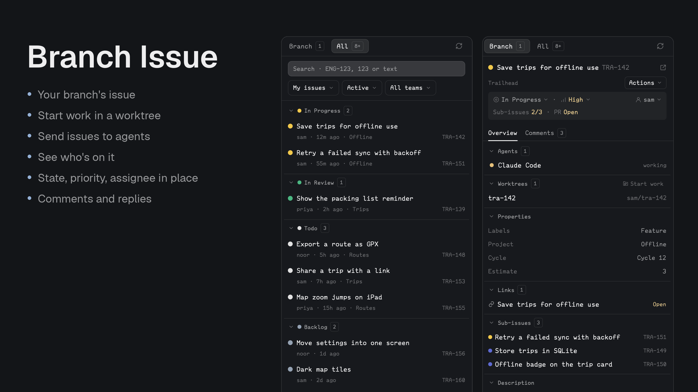

# Branch Issue

A Linear panel for [Herdr Desktop](https://herdr.dev/), built to look like Herdr's own panels and to fit how you work with agents: see where an issue stands, give it its own worktree, hand it to an agent, and keep it up to date. A sibling of [Branch PR](../branch-pr/README.md).



- **Two lists in the sidebar:** **Branch** for the issues on your checkout's branch, which goes straight to the details when there's only one, and **All** with search, My issues / Active cycle / All issues, state and team filters, grouped by workflow state in collapsible groups. Opening an issue stays in the sidebar, like a commit in Better Changes.
- **At a glance:** state, priority and assignee sit on one line under the title, and change right there. Sub-issues done and pull request status appear below them when an issue has them.
- **Create worktree:** a worktree using Linear's own branch name, started from a branch you pick, `main` by default, which is how you stack one PR on another, opened as its own space with a terminal or an agent, and optionally moved to Started. An agent gets the issue's link and details, and waits for your next message before doing anything.
- **Agents:** those working on the issue are listed with their state; click one to go to it. **Send to agent** hands over the issue or a comment thread with a prompt you can edit, to an agent you pick from a dropdown, a sub-agent under it with **(spawn)**, or a new one in its own tab. New ones work in the issue's worktree if it has one.
- **Properties:** labels, project, cycle and estimate in the Overview.
- **Links and sub-issues,** with pull request status.
- **Comments:** threads, Reply, a link for each comment, and a box for a new one after the last.
- Local and remote spaces: Git runs on the space's machine, and the Linear helper on this computer.

## Upgrading from 1.x

2.0 is a rebuild around working with agents, and it removes some things:

- **The All issues center tab** is gone: the **All** tab in the sidebar replaces it. Close any old tab, and remove any `props: { "mode": "browser" }` tab or command you set up.
- **The commands** `open-browser`, `toggle`, `open`, `back`, `description`, `comments`, `links` and `worktree` are gone. `refresh` stays.
- **Editing comments, Markdown preview and editing labels** are gone. Linear still has all of them.
- **The `tracker` setting** is gone, since Linear is the only one. Updating keeps your other settings.
- **Icons moved** to `icons/`, so change a Better Tabs button's `mods/branch-issue/issue.svg` to `mods/branch-issue/icons/issue.svg`.

## Install only this mod

Copy this prompt into your Herdr agent:

> Read ~/.config/herdr-app/AGENTS.md, then add this mod: https://github.com/munza/herdr-mods/tree/main/branch-issue

Requirements: **Go 1.23+** to run the installer and build the helper, Git on the machines your spaces run on, and a **Linear personal API key**. Agent actions use `hc` and a running agent.

The helper talks to Linear's GraphQL API with the key from the **`LINEAR_API_KEY`** environment variable and nothing else: there's no key field, keychain entry or token file. Create a personal key at https://linear.app/settings/api and export it in your shell. The helper reads its own environment, then asks your login shell, so a key exported in `.zshrc` or by home-manager is found even when Herdr was launched from the Dock. If the key is missing or rejected, the panel says so, shows what to run, and offers Try again.

Read [RECIPE.md](RECIPE.md) and the source before installing. The helper sends your key to api.linear.app only and never stores it. On an explicit click the panel can **post comments and replies, change an issue's state, priority and assignee, fetch a base branch and create Git worktrees and branches, write the branch-to-issue link to Git config, open spaces, and send messages to agents.** Nothing writes on its own. Messages to agents tell them to treat Linear's text as data and not to post unless asked.

From this folder:

```sh
go -C helper run ./install          # first install
go -C helper run ./install --update # later
```

The installer builds the helper, copies only `mods/branch-issue/` to `~/.config/herdr-app/mods/branch-issue/`, and runs `herdr-app check`. It doesn't edit layouts or keys.

### Place the sidebar

The manifest has `place: none`, so add it to a layout you own, about 368px wide:

```json
{ "id": "linear-issues", "type": "block", "content": { "mod": "branch-issue" } }
```

With Better Tabs, a button can open it (`target` is that block's layout ID):

```json
{
  "id": "issues",
  "label": "Issues",
  "icon": "mods/branch-issue/icons/issue.svg",
  "action": { "type": "panel", "container": "panel", "stack": "panel-body", "target": "linear-issues" }
}
```

## How it finds issues

The sidebar follows the active terminal's folder and branch. It joins the identifiers in `git config branch.<branch>.herdr-issue` (comma separated) with any `TEAM-123` in the branch name, confirms each with Linear, and drops those that don't exist, so `main` or `release-2024` never resolve. With nothing found, **Link issue** confirms an identifier with Linear and writes the link. An issue linked by hand can be unlinked from **Actions**; one named by the branch has no such option, since it would simply be found again.

Search waits 450ms and starts at three characters, or at any length for a number, which matches that number in any team. Linear matches titles and descriptions, and `ENG-123` matches that identifier. `+ more` at the end of the list loads the next batch.

A hidden panel doesn't refresh, and catches up when shown.

## Commands

`branch-issue.refresh` reloads. Commands reach copies that are showing.

## Settings

[Better Config](../better-config/README.md) shows these with what each one does, and changes, checks and resets them for you. By hand:

Add a `settings` block to the installed `mods/branch-issue/mod.json` with only what you change. It is kept across `--update`. `mod.schema.json` beside it describes every setting, so an editor that reads `$schema`, such as VS Code or Zed, checks the block as you type. The defaults:

```json
"settings": {
  "refresh": { "every": "60s", "search_debounce": "450ms" },
  "branch": { "max_identifiers": 4 },
  "list": { "default": { "scope": "mine", "state": "active", "team": "" } },
  "worktrees": { "root": "~/.herdr/worktrees", "open_with": "terminal", "move_to_started": false }
}
```

`refresh.every` is how often a visible panel re-reads. `branch.max_identifiers` caps how many identifiers one branch may carry. `list.default` picks the first filters until a saved view exists. `worktrees.root` is where Start work puts checkouts; `open_with` is `terminal` or an installed agent's key; `move_to_started` preselects that option. Unknown keys and wrong types are reported at the top of the panel and ignored.

## Development

```sh
node --test tests/*.test.cjs
(cd helper && go test ./... && go vet ./...)
herdr-app check "$HOME/.config/herdr-app/mods/branch-issue"
```

`mods/branch-issue/main.js` lists what's where. `linear/model.js` says what Linear's answers mean, `linear/` reads, `actions/` writes and hands off, `views/` draws with `views/ui.js`, and `icons/` holds the icons. `helper/main.go` is the JSON bridge to Linear's GraphQL API, with validated requests and a 26-second timeout. Tests use stand-ins for Linear, so also look at the running app.

See [LICENSE](../LICENSE) and [NOTICE](../NOTICE) for attribution.
