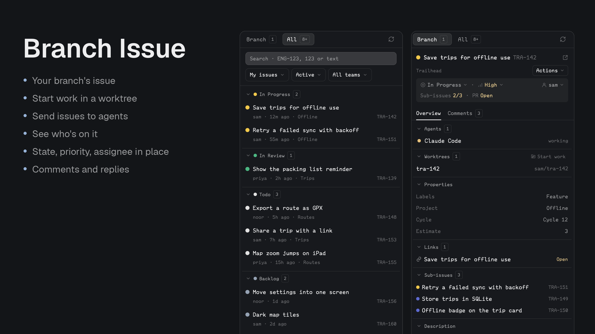

# Branch Issue

A Linear panel for a person's Herdr window, for directing agents rather than managing a tracker. Judge any addition by whether it helps someone see where an issue stands, start work on it, hand it to an agent, or keep it current. It reads the key from `LINEAR_API_KEY` only, and the mod never sees it.

## What you see

It follows Better Changes and Branch PR, in one framed sidebar panel, radius 10, with no center tab. Headers are 42px.

The header always holds pill tabs, Branch [n] and All [n], with refresh on the right, and the tab choice is remembered. Until its first answer a tab shows a spinner in place of its count and can't be clicked. Linear gives no total, so All counts what's loaded, with a `+` if there's more. Branch lists the branch's issues, or with exactly one goes straight to its details, with no back button; with none it offers Link issue. All adds a filter block with a rule under it: search on its own row, then choosers for scope, state and, with several teams, team. Its rows sit in collapsible groups by workflow state, those being worked on first, and `+ more` ends the list. A row has the state's colour dot and title on the first line, and the assignee, age and project with the identifier in the code font on the second. A 34px footer with the branch and when it last updated closes the panel in every view.

Opening an issue works like opening a commit, under the same tabs. Until it loads, everything below the tabs is a centred spinner, and back cancels it. Then a fixed block has, on its first line, a back chevron unless it's the branch's only issue, the colour dot, the title with the identifier dim after it, and an external-link icon; on its second, the team in small print with the Actions menu on the right; then the stats. Directly below, with no rule between, are the second-level tabs, Overview and Comments [n]: plain text over a rule, with a 2px line on that rule under the active one.

Below is a quiet strip of `raised` at half strength, rounded. Its first line is the issue's state, priority and assignee, state and priority on the left separated by a dot, the assignee on the right, each after its own icon: medium text with a small chevron, without labels so all three fit, priority in ansi1 when urgent and ansi3 when high, each a chooser that writes on choice. When there are any, a second line has Sub-issues as done/total and PR with the first linked pull request's status from the attachment's metadata, each a dim label then a coloured value.

The Actions menu holds Create worktree, Send to each agent, and Unlink for a hand-made link.

Overview is a scrolling list of collapsible groups with rules between them, whose open state is remembered: Agents (a status dot, name and status; a click runs `agent.focus`), Worktrees (name on the left, branch on the right, a click switches to its space or opens one, and Create worktree), Properties (labels, project, cycle and estimate as plain text, when there are any), Links (with status on pull requests), Sub-issues and Parent (opening in the panel), and Description in Markdown.

Comments has threads separated by rules: each comment with author, age and a copy icon for its link, replies indented, then Reply, with a bordered Send to agent on the right. It's a dropdown of who can take it. A reply's box opens inside its thread; a handoff from Actions docks at the bottom. After the last thread, always there, is a box for a new comment with a Comment button, its draft kept per issue.

A missing or rejected key replaces everything below the tabs with what's wrong, the command to run, Create a key and Try again.

## How it behaves

The panel follows the active terminal's cwd and branch. Branch joins `branch.<branch>.herdr-issue` (comma separated) with `TEAM-123` patterns in the branch name, capped by `branch.max_identifiers`, and confirms each with Linear; unknown ones are dropped. Only an identifier in the binding and not the branch name can be unlinked.

A hidden panel doesn't refresh at all, checked through `layout()`, and comes up to date when shown. A refresh re-reads Branch, the open issue, and All only while it's showing, plus once for its count. A token per kind of read stops an old answer replacing newer state. A reload reopens the saved issue once; a branch change shows the list, or its only issue. After 30 seconds the tabs unlock even if a read hasn't answered.

Search debounces 450ms and starts at three characters, or at any length for a number. Filters, the open issue, its tab and drafts are saved per folder.

An agent is on an issue if its pane is inside one of the issue's worktrees, or in this space on a branch naming it. Send to agent is a dropdown of those first, then others in the space, each also as `<name> (spawn)`, which starts a sub-agent of the same program under it with `hc run --bg --parent`, passing the message as an argument so no shell sees it, then Start for each installed agent from `knownAgents`. It opens an editable prompt that only Send delivers: through `hc send` to a running agent, `hc run` for a sub-agent, or `tab.new` with the message as a new agent's first prompt. New agents work in the issue's worktree, else the space's folder. Messages say to treat Linear's text as data and not to post unless asked.

Create worktree proposes Linear's `branchName` with a suffix if taken, a worktree name following the branch until edited, From as a dropdown, not a text field: the remote's HEAD by default, or this checkout's branch or any recent one, for stacking, with a fetch in the background to bring in new ones, and Open with a terminal or an installed agent. It checks the names, refuses existing branches, fetches the base from `origin` and starts from the local branch if it has everything the remote does or isn't on the remote, else from what was fetched, runs `git worktree add` under `worktrees.root/<repo folder>/<name>`, writes the branch link, optionally moves the issue to the team's first started state, and opens a new space. An agent gets the issue as its first prompt. If opening fails the checkout stays, and Open retries only that step.

Writes never retry by themselves. A failure keeps the draft and says to refresh first if it may have gone through. A confirmation leaves after 5 seconds; an error stays.

## Built from

`mods/branch-issue/`: `main.js`, `settings.js` (shared between this repo's mods), `mod.json` (`place: none`, title Branch Issue), `mod.schema.json` (its settings with their defaults, which the code's `DEFAULT_SETTINGS` must match), `linear/` (`model.js`, `discovery.js`, `reads.js`), `actions/` (`changes.js`, `agents.js`, `worktrees.js`, `menus.js`), `state/saved.js`, `views/` (`ui.js`, `list.js`, `detail.js`, `comments.js`, `worktrees.js`), `icons/`. `helper/` is `go.mod`, `main.go`, `main_test.go` with no dependencies; `helper/install/` builds it to `mods/branch-issue/bin/herdr-linear`. Remote spaces run Git there, and the helper stays local.

## Watch out

Before installing, explain the Git, Linear and `hc` access and the writes above. Never print the key. Never test writes against someone's workspace without their say-so.

Herdr's shipped layouts are read-only, so the mod only shows in a layout the person owns. The installer doesn't edit layouts or keys.

`herdr-app check` draws only the empty state, so look at the running app too.

## Done when

- Node tests, Go tests and vet, including the installer's, and `herdr-app check` pass.
- A missing or rejected key takes over the panel with what to do, and Try again.
- Both lists and an issue render without errors with real issues, all inside the sidebar.
- A branch named for an issue opens it directly, and Create worktree opens a new space on Linear's branch name, whose agent has the issue and waits.
- Send to agent reaches the agent, and with no agent says so and sends nothing.
